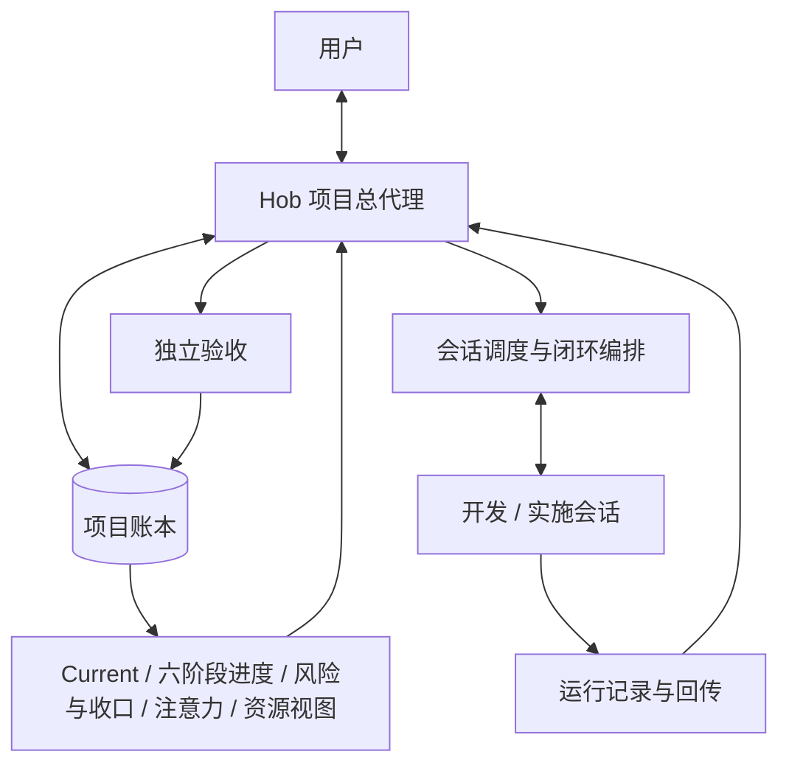
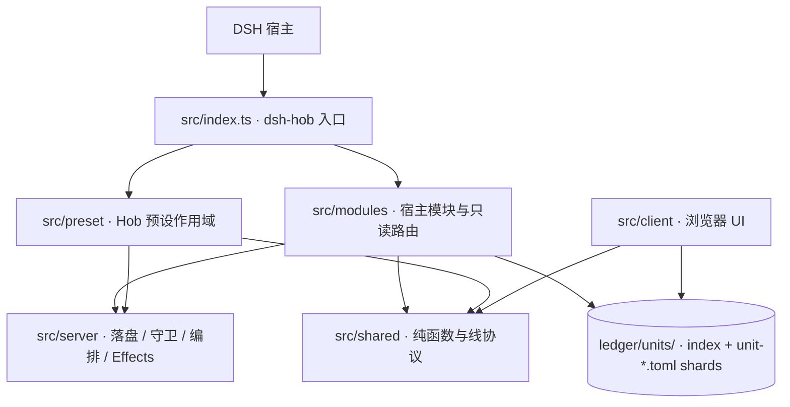

# dsh-hob 现行架构

> 本图只表达稳定层次和依赖方向，不写会漂移的文件数。
> 旧 v4 图已移至账本区
> `archive/2026-11-03-architecture-refresh/legacy/`，只作历史参考。

## 一、全局关系



“总代理”是用户授权范围内的项目协调权。Hob 不实现业务代码、不执行命令；
开发会承担实施，验收由独立于实施者的判决产生。

委托关系里，用户始终保留目标、产品取舍、可接受代价与不可逆动作的决定权。Hob 只在
这份授权内组织项目；它不能扩大自己的权限，也不能代替用户接受自己的实现。

## 二、代码分层



## 三、两条主链路

### 1. 创建 Hob 会话

```text
UI 新建入口
  → session-create 一次性票据
  → 建空白会话
  → 写入逐会话可读档与工作方式
  → 隔离回读确认
  → 用户进入会话
```

### 2. 推进项目

```text
用户需求
  → Requirement（v3，内容完成）
  → G1 用户确认需求当前修订
  → Change（v3，内容完成 + 风险评定）
  → G2 用户确认方案当前修订并选择路径
  → Task graph（v3，DAG + 覆盖）
  → Dispatch（任务、父方案、承接需求全部过闸）
  → Run / 回传（运行态事实自动投影成账本 RUN / TSK 状态）
  → Acceptance / Evidence
  → Current 与下一步
```

运行态与账本是**两个事件源、一条事实链**：派发 / 回传 / 判决先在运行态发生，
再由 `ledger-projection.ts` 的纯函数算出确定性账本操作，最后由 `projection-writer.ts`
经 `writeHobFile` 同一道守卫落盘。投影失败**不回滚**已发生的运行态事实，
但必须在 `hob_orch_status` 与工具返回值里如实报出「账本未落」。

阶段字段与完成口径仍在 `stage-controls.ts` 定义；单条需求的「当前阶段」、
当前闸门与责任方**只由 `pipeline-view.ts` 提供**。`/stages` 的 `pipelines` 与
`/requirement-chains` 的 `pipeline` 都是这份视图的投影，面板不得另算一套。
第 3 步要求任务图无环、无悬空依赖且每个验收条件都有任务覆盖（G3/C-5）；
第 4 步要求 `RUN returned + TSK built` 同时成立；第 5 步是独立技术验证（G4/C-25）；
第 6 步是产品验收（G5）；第 7 列是按风险启用的交付收口（G6/C-27）。全局 `stages`
数组只作为账本清单与历史展开，不回答「当前在第几步」。

### 3. Pipeline v3 · 六阶段、风险门与 clean cut

- 正式六阶段：需求 → 方案 → 任务图 → 执行 → 技术验证 → 产品验收。
- 交付收口是产品验收后的风险启用门，不冒充第七个业务阶段。
- 第 1、2 步各有独立用户闸门：`G1-requirement` / `G2-plan`。
- 内容完成、状态写成 `agreed/settled`、或用户只说「继续 / 可以」，
  都**不构成批准**。批准必须是一条独立的 `decision` 审计单元：
  `decision_kind=stage-approval`、当前 `artifact_revision`、内容摘要、
  `decided_by=user`、用户回执原文与时刻。
- `draft/proposed` 属于 Hob 仍在起草，允许保存但不能表达成“等用户确认”；
  内容写到 `agreed/settled` 后才进入 G1/G2 等用户回执。
- 需求或方案内容改变必须递增正整数 `revision`；旧批准随即因版本或摘要不符而
  `stale`，必须重新确认。方案批准还必须选中当前 `path_options` 中的路径。
- v3 是 clean cut：新 `req/change/task/run/verification/acc/closure` 必须带
  `pipeline_version="v3"` 与 `revision`。v2 旧条目保留只读展示，不回填、不伪造批准，
  也不得进入 v3 派发。
- 风险由 `risk-policy.ts` 唯一推导：硬触发与单维下限取最高档，不允许平均降档；
  固有风险决定评审深度和 G6 档位，残余风险决定验收/交付是否可接受。
- 每条硬触发必须有六段式事实（事实 / 影响 / 证据 / 控制 / 残余），并与方案事实摘要绑定；
  任务执行风险（`task_risk`）独立决定拆小、隔离、独立复核与串行，同路径任务不得并行。
- G6 必须绑定 G5 接受、所用风险评定与残余风险决定；`skipped` 也留下理由与决定者。
- 派发门禁同时检查任务、父方案、方案承接的每条需求、方案未被取代与任务书完整；
  任一闸门未过即拒绝，并返回可读原因。

跨进程副作用使用 Effects/Outbox；运行态落在账本区 `runtime/`，不进入 Git。

### 4. 账本契约与投影边界

账本单元的 `kind/status` 是封闭契约。结构校验只有 `ledger-validation.ts` 一份，
阶段接口、就绪度门禁和写入守卫都调用它；字段与关系门禁仍在 `stage-controls.ts`。
方案承接需求统一读取 `req_ids / addresses / requirement_coverage`，
不允许各视图只认其中一种字段。

运行态投影按**账本根**串行：一次投影包含“读全账本 → 分配编号 → 写多分片”，
单个文件队列不足以保护它。回传只迁 `RUN.returned`；只有带小步验证读数时才把
`TSK` 迁到 `built`。单目标派活必须给真实 `TSK-*`，自由描述不能代替账本对象。

## 四、权威入口

| 对象 | 权威位置 |
|---|---|
| 插件与模块入口 | `src/index.ts` |
| 配置 schema | `src/config.ts` |
| Hob 工作流 | `preset/dsh-hob/workflow.toml` + `spec/` |
| 预设生成物 | `preset/dsh-hob/gen/` |
| 项目账本 | `<ledgerHome>/<workspaceName>/ledger/units/` |
| 当前视图 | `<ledgerHome>/<workspaceName>/ledger/spec/current.md` |
| 权威阶段接口 | `POST /api/dsh-hob/stages` |
| 按 ID 资源接口 | `POST /api/dsh-hob/ledger-resource` |
| 运行态 | `<ledgerHome>/<workspaceName>/runtime/` |

## 五、命名原则

- `dsh-hob`：包、插件 entry、设置 namespace、HTTP 路由前缀。
- `Hob`：项目总代理预设和角色。
- `hob_*`：Hob 对外行为工具。
- `G- / R- / CHG- / TSK- / RUN- / ACC- / EVD- / RSK- / DEC- / CAP-`：账本稳定 ID。
- `Current`：当前工作入口。
- `stages`：权威阶段清单与七列汇总面；`tasks-progress` 仅保留兼容。

完整术语见项目根 `TERMINOLOGY.md`。

## 六、文档生命周期

文档按职责分层，同一事实只允许一个权威落点：

| 文档层 | 权威位置 | 写什么 | 不写什么 |
|---|---|---|---|
| 用户入口 | `README.md` | 安装、使用、限制 | 当前项目状态 |
| 术语契约 | `TERMINOLOGY.md` | 固定名称与边界 | 实现细节 |
| 架构说明 | `kit/drafts/architecture-overview.md` | 稳定层次与依赖方向 | 会漂移的文件数 |
| 行为规格 | `preset/dsh-hob/spec/` · `ledger/spec/` | 当前可观察行为 | 历史过程 |
| 机器状态 | `ledger/units/` 索引分片 | 唯一状态与正式关系 | 长篇说明 |
| 派生视图 | `ledger/gen/` · `ledger/spec/current.md` · `REQUIREMENTS.md` | 从索引生成的人读汇总 | 手工状态更新 |
| 方案变更 | `ledger/changes/` | 提案、差异、任务边界 | 长期现状 |
| 历史追溯 | `volumes/` · `archive/` | 已退役正文与原始证据 | 当前执行依据 |

更新规则：

1. 当前事实变化时**替换原正文**，旧版本归档；⛔ 不在末尾持续追加“补充说明”。
2. 同一主题只允许一份现行文档；被替代文档必须标明 `superseded_by` 或归档位置。
3. `gen/`、`Current`、`requirements.md`、`portfolio.md`、`stages.md` 只读生成物，⛔ 手改。
4. `PROJECT.md` 只做 ≤200 行薄地图；状态与计数留在索引或生成视图。
5. 新文档增加前先回答“能否更新现有同主题文档”；只有职责不同才拆新文件。
6. 历史文档可以保留旧称和旧路径，但必须明确标为只读追溯，⛔ 不再作为当前判断依据。

需求变更沿 `Goal → Requirement → Change → Task → Run → Acceptance` 回流；
任何一层缺失由账本判据点名，而不是靠新增一份说明文档补洞。
