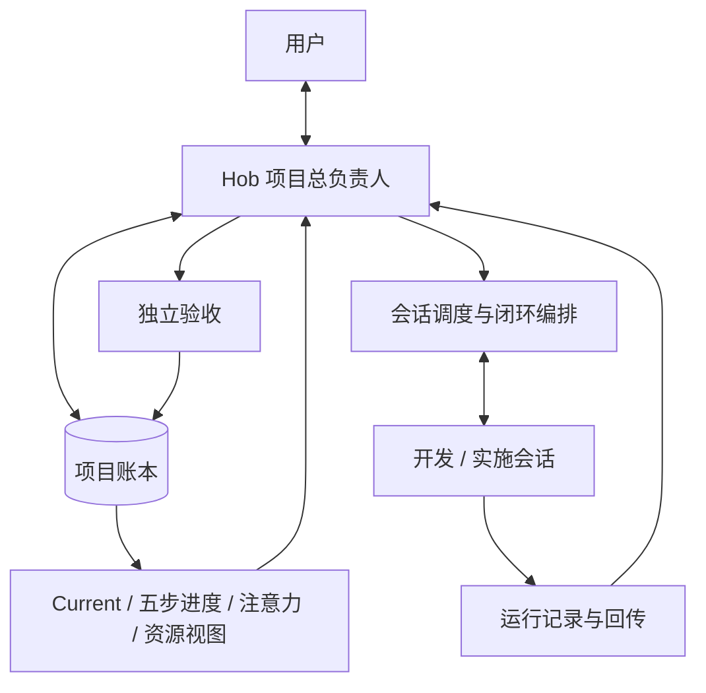
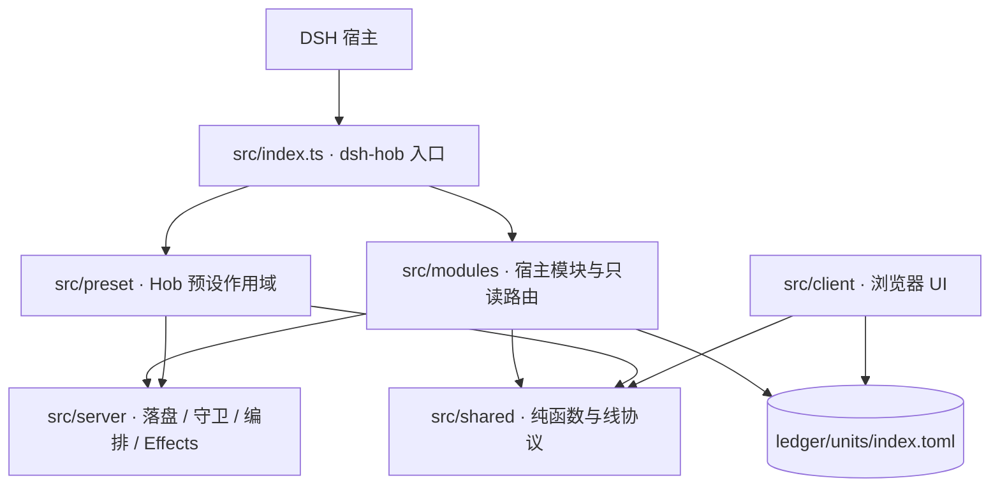

# dsh-hob 现行架构

> 本图只表达稳定层次和依赖方向，不写会漂移的文件数。
> 旧 v4 图已移至账本区
> `archive/2026-11-03-architecture-refresh/legacy/`，只作历史参考。

## 一、全局关系



“总负责人”是结果责任和协调权。Hob 不实现业务代码、不执行命令；
开发会承担实施，验收由独立于实施者的判决产生。

## 二、代码分层



## 三、两条主链路

### 1. 创建 Hob 会话

```text
UI 新建入口
  → session-create 一次性票据
  → 建空白会话
  → 写入逐会话可读档与工作方式
  → 隔离回读确认
  → 用户进入会话
```

### 2. 推进项目

```text
用户需求
  → Goal / Requirement
  → Change / Task
  → Dispatch
  → Run / 回传
  → Acceptance / Evidence
  → Current 与下一步
```

跨进程副作用使用 Effects/Outbox；运行态落在账本区 `runtime/`，不进入 Git。

## 四、权威入口

| 对象 | 权威位置 |
|---|---|
| 插件与模块入口 | `src/index.ts` |
| 配置 schema | `src/config.ts` |
| Hob 工作流 | `preset/dsh-hob/workflow.toml` + `spec/` |
| 预设生成物 | `preset/dsh-hob/gen/` |
| 项目账本 | `<ledgerHome>/<workspaceName>/ledger/units/index.toml` |
| 当前视图 | `<ledgerHome>/<workspaceName>/ledger/spec/current.md` |
| 权威阶段接口 | `POST /api/dsh-hob/stages` |
| 按 ID 资源接口 | `POST /api/dsh-hob/ledger-resource` |
| 运行态 | `<ledgerHome>/<workspaceName>/runtime/` |

## 五、命名原则

- `dsh-hob`：包、插件 entry、设置 namespace、HTTP 路由前缀。
- `Hob`：项目总负责人预设和角色。
- `hob_*`：Hob 对外行为工具。
- `G- / R- / CHG- / TSK- / RUN- / ACC- / EVD- / RSK- / DEC- / CAP-`：账本稳定 ID。
- `Current`：当前工作入口。
- `stages`：权威五步汇总面；`tasks-progress` 仅保留兼容。

完整术语见项目根 `TERMINOLOGY.md`。
